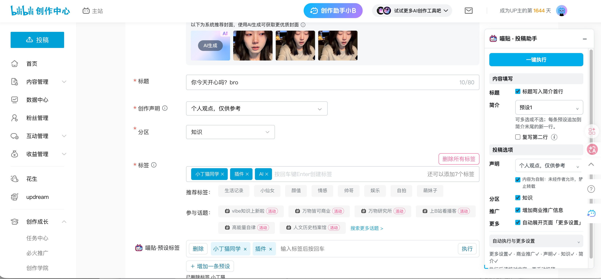

<div align="center">
  <a href="https://bv.lcat.cc/">
    
  </a>
  <h1>让 B 站投稿，少一点重复。</h1>
  <p>简介、标签、投稿设置，一次备好。把时间留给下一次创作。</p>
  <p>
    <a href="https://bv.lcat.cc/">访问官网</a> ·
    <a href="https://bv.lcat.cc/#install"><strong>安装喵贴</strong></a> ·
    <a href="https://bv.lcat.cc/tutorial.html">使用教程</a> ·
    <a href="https://bv.lcat.cc/changelog.html">更新日志</a> ·
    <a href="https://github.com/GarryJung/BiliClip/issues">反馈问题</a>
  </p>
  <p>桌面浏览器扩展 · B 站网页版 · 当前离线版本 <strong>8.2.1</strong></p>
</div>

---

## 创作继续，重复的事交给喵贴

喵贴 BiliClip 是为 B 站创作者准备的浏览器扩展。在原有投稿页面里整理常用文案、标签与投稿选项，也能复制视频信息、查找并关联自己的作品。

| 功能 | 怎么用 |
| --- | --- |
| **投稿助手** | 集中准备标题、简介、声明、分区等设置，按需一键执行。 |
| **简介预设** | 保存常用文案，支持多选、追加，以及按需复写第二行。 |
| **标签预设** | 按组保存标签，投稿时独立执行，减少反复输入。 |
| **关联视频库** | 搜索自己的视频与合集，将 BV 和标题分别填入关联内容。 |
| **视频信息复制** | 在视频封面或详情页复制 BV、标题和链接。 |
| **操作引导** | 从工具栏菜单随时重开引导，熟悉各个面板。 |

喵贴辅助填写和操作，执行后请核对内容，最后由你手动投稿。

## 看看实际效果

### 投稿与预设



### 关联自己的作品


[查看完整使用教程 →](https://bv.lcat.cc/tutorial.html)

## 安装喵贴

**推荐先到[官网安装区](https://bv.lcat.cc/#install)选择你的浏览器**，查看对应商店入口与图文教程。

| 浏览器 | 安装方式 |
| --- | --- |
| **Chrome** | 从 Chrome 商店安装；商店无法访问时，可下载官网离线 CRX。 |
| **Firefox** | 从 Firefox 附加组件商店安装，使用专用版本。 |
| **Edge** | 从 Microsoft Edge 扩展商店安装。 |
| **360 浏览器** | 从 360 插件应用商店安装。 |
| **Arc、Dia、Comet、QQ、夸克、2345、百分、UC、搜狗等 Chromium 衍生浏览器** | 可从 Chrome 商店安装；无法访问时，使用同一份 Chrome 离线 CRX。 |

[前往官网安装](https://bv.lcat.cc/#install) · [下载离线 CRX 8.2.1](downloads/BiliClip-8.2.1-offline.crx) · [离线安装图解](https://bv.lcat.cc/tutorial.html#install)

离线下载直接提供 `.crx` 文件。Firefox、Edge 和 360 不提供离线包；各商店版本以详情页为准。

## 找到作者

**小丁猫同学 · Garry Jung**

用心创作，终会万众瞩目！欢迎交流使用体验、分享创作工作流，或反馈遇到的问题。

| 平台 | 主页 / 联系方式 |
| --- | --- |
| **GitHub** | [GarryJung](https://github.com/GarryJung) |
| **bilibili** | [小丁猫同学](https://space.bilibili.com/377939379) |
| **小红书** | [小丁猫同学](https://www.xiaohongshu.com/user/profile/5d69cf940000000001001a37) |
| **X / Twitter** | [@TavvCat](https://x.com/TavvCat) |
| **Reddit** | [u/garryjung](https://www.reddit.com/user/garryjung/) |
| **邮箱** | [i@lcat.cc](mailto:i@lcat.cc) |

[关于作者与其他作品](https://bv.lcat.cc/author.html) · [提交问题或建议](https://github.com/GarryJung/BiliClip/issues)

反馈时请附上浏览器及版本、喵贴版本、安装渠道和复现步骤；截图请遮住账号等私人信息。

## 隐私与权限

喵贴的预设与配置保存在本地，不接入开发者广告、统计或追踪服务。有关扩展权限和数据处理方式，请查看[隐私与权限说明](https://bv.lcat.cc/privacy.html)。

## 关于这个仓库

本仓库用于发布 **喵贴官网和当前 Chrome 离线 CRX**。不再提供油猴脚本、历史安装包、扩展源码或商店提交资料。`assets/` 中的 JavaScript 用于官网粒子背景、互动演示、安装选择和图片预览。

官网使用原生 HTML、CSS 和 JavaScript，无需构建依赖。本地预览：

```sh
python3 -m http.server 8000
```

打开 `http://localhost:8000`。推送到 `main` 后由 GitHub Pages 工作流部署。

---

<div align="center">
  
  <p><strong>灵感归你，重复的事交给喵贴。</strong></p>
  <p>独立开发项目，非哔哩哔哩官方产品。</p>
</div>
