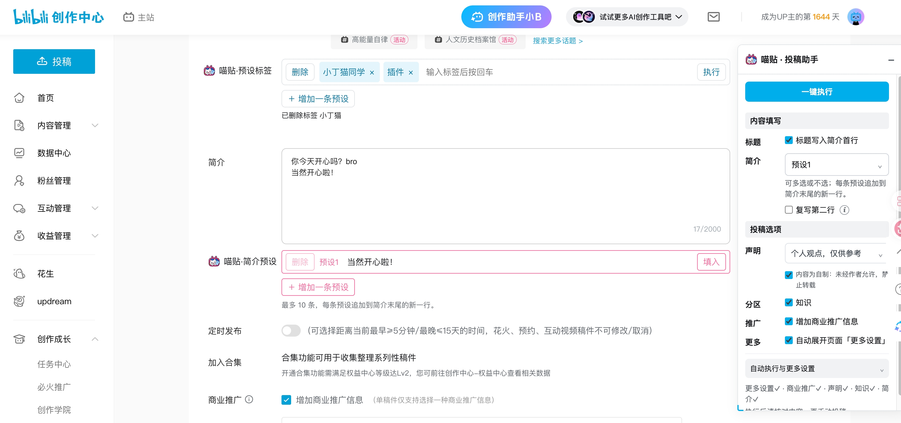

<div align="center">
  
  <h1>喵贴 BiliClip</h1>
  <p><strong>把重复交给喵贴，专心创作就好。</strong></p>
  <p>B 站网页版投稿助手：简介预设、标签预设、投稿设置、视频信息复制与关联视频库。</p>
  <p>
    <a href="https://bv.lcat.cc/">官网</a> ·
    <a href="https://bv.lcat.cc/#install">安装喵贴</a> ·
    <a href="https://bv.lcat.cc/tutorial.html">使用教程</a> ·
    <a href="https://bv.lcat.cc/changelog.html">更新日志</a> ·
    <a href="https://github.com/GarryJung/BiliClip/issues">反馈问题</a>
  </p>
  <p>当前脚本 / 离线扩展：<strong>8.2.1</strong> · 桌面浏览器 · 免费使用</p>
</div>

## 喵贴能帮你做什么

从找到一条视频，到完成一次投稿，把常用内容和重复操作提前备好。

| 场景 | 喵贴帮你做的事 |
| --- | --- |
| 投稿设置 | 将标题写入简介首行，追加所选简介预设，应用声明、分区等已勾选设置 |
| 简介预设 | 保存常用文案，多选或不选；支持逐条追加，也可按需复写第二行 |
| 标签预设 | 按组保存常用标签，独立执行；按当前标签余量添加，跳过已有标签 |
| 视频信息复制 | 从封面复制「BV + 标题」或「标题 + 链接」；详情页可按需单独复制 |
| 关联视频库 | 搜索本人已发布视频及合集，将视频链接与描述分别填入对应字段 |
| 实操引导 | 跟随页面上的高亮提示操作，可关闭、跳过或从菜单重新开始 |

喵贴负责填入和辅助操作，**最终投稿由你核对并手动提交**。一键执行不会自动执行标签预设，标签组需要单独点击执行。

## 看看实际效果

以下为 B 站网页版中的实际使用截图，点击图片可查看原图。

### 投稿助手：常用设置，一处备好

在右侧面板选择本次需要执行的项目，再点击「一键执行」。预设标签直接放在投稿表单中，编辑与执行都不用离开页面。

[](assets/screenshots/real-upload.jpg)

### 简介预设：把常用文案留下来

在简介下方编辑预设，在投稿助手中选择要使用的内容。默认按预设顺序逐条追加到简介末尾；勾选标题写入首行时，会替换简介第一行，保留后续正文。

8.2.1 新增「复写第二行」，默认关闭。开启后，所选预设从第二行写入，保留后续正文；未选预设时不改写。重复执行追加操作会再次追加，请核对结果。

[](assets/screenshots/real-description.jpg)

### 关联视频库：选中稿件，分别填入

打开关联视频编辑器后，在视频库中搜索或选择本人稿件。点击「填入」，把链接与描述写入右侧表单；「播放」会另开视频页，方便确认内容。

[](assets/screenshots/real-library.jpg)

### 封面复制：跟着提示，一次带走信息

蓝色按钮复制「BV + 标题」，粉红色按钮复制「标题 + 链接」。需要关联视频时，也可以先复制，再到对应表单中粘贴。

[](assets/screenshots/real-copy.jpg)

截图展示的是已有的实际操作场景；8.2.1 的面板尺寸、菜单分组和「复写第二行」等新增细节，以当前安装版本为准。

## 安装

**扩展版和脚本版选一种启用即可**，避免重复按钮或操作冲突。安装后刷新已打开的 B 站页面。

### 方式一：浏览器商店

使用对应浏览器打开下列入口，按商店提示安装。商店版本、更新时间和可用状态以详情页为准，可能与仓库中的 8.2.1 不同。

| 浏览器 | 安装入口 |
| --- | --- |
| Edge | [Microsoft Edge 扩展商店](https://microsoftedge.microsoft.com/addons/detail/kiifbllklilololdabaifmhnaaaokjlc) |
| Firefox | [Firefox 附加组件商店](https://addons.mozilla.org/zh-CN/firefox/addon/biliclip%E5%96%B5%E8%B4%B4-b%E7%AB%99%E4%B8%80%E9%94%AE%E5%A4%8D%E5%88%B6bv%E7%A0%81%E6%A0%87%E9%A2%98/) |
| 360 浏览器 | [360 扩展商店](https://ext.se.360.cn/#/extension-detail?id=dgigoaikkdcenigcnaeimgnfinocefkd) |

Chrome 商店版准备上架。Chrome、Dia、Comet、百分浏览器的安装入口和步骤见[官网安装区](https://bv.lcat.cc/#install)，也可使用下面的离线包或脚本方案。

UC、夸克、QQ、搜狗的入口已列在官网；不同桌面版本的扩展支持可能不同，喵贴扩展兼容性仍待实测。Safari 版暂未发布。

### 方式二：8.2.1 Chrome 离线扩展

1. [下载 8.2.1 离线安装包](https://bv.lcat.cc/downloads/BiliClip-8.2.1-Chrome-offline.zip)，解压并保留完整文件夹。
2. 在 Chrome 地址栏输入 `chrome://extensions`，打开扩展管理页，开启「开发者模式」。
3. 点击「加载已解压的扩展程序」，选择含有 `manifest.json` 的文件夹。
4. 刷新 B 站页面。首次安装会直接打开[官网欢迎页](https://bv.lcat.cc/welcome.html)，可先浏览使用案例；普通更新和重载不弹出欢迎页。

[查看仓库中的离线包](downloads/BiliClip-8.2.1-Chrome-offline.zip) · [完整安装教程](https://bv.lcat.cc/tutorial.html#install)

### 方式三：油猴脚本

1. 安装 [Tampermonkey](https://www.tampermonkey.net/) 或 [Violentmonkey](https://violentmonkey.github.io/)。
2. 点击[安装喵贴脚本 8.2.1](https://bv.lcat.cc/biliclip.user.js)，在管理器中确认安装。
3. 刷新 B 站网页版，确认脚本已启用。

如果打开后只显示源码，请检查管理器是否已安装、启用并允许在当前浏览器中运行脚本。也可将[脚本源码](biliclip.user.js)复制到管理器的新建脚本中保存。

## 第一次使用

1. **打开 B 站网页版。** 在视频封面上体验复制按钮；详情页还可分别复制 BV、标题或链接。
2. **进入创作中心并上传视频。** 在投稿助手中选择所需设置；在简介、标签区域保存自己的预设。
3. **执行并核对。** 投稿设置点击「一键执行」，标签预设按组执行。需要关联视频时，打开关联编辑器，再从视频库选择填入。
4. **确认后手动投稿。** 检查简介、标签、声明、分区及关联视频是否符合本次稿件。

扩展版点击浏览器工具栏中的喵贴图标打开菜单；脚本版从脚本管理器菜单进入。选择「引导教程」可以重新开始页面实操引导。

## 8.2.1 更新

- Chrome、Edge、Firefox、360 首次安装统一打开官网欢迎页，后续网页内容可独立更新。

- 初始面板高度随浏览器可用高度调整，预留顶部与底部空间。
- 投稿助手与视频库引导增加从边缘拖动调整大小的说明。
- 简介预设新增「复写第二行」，默认关闭，并提供悬停和键盘聚焦说明。
- 工具栏菜单按开始使用、当前页面操作、官网与作者分组，强化引导入口与键盘焦点。

[本版说明](versions/8.2.1/版本说明.md) · [8.2.1 脚本归档](versions/8.2.1/biliclip-8.2.1.user.js) · [完整更新日志](https://bv.lcat.cc/changelog.html)

## 隐私与权限

喵贴没有开发者服务器，不接入广告、统计或追踪服务，不向开发者发送数据。预设、设置、面板位置、引导进度及视频库缓存保存在浏览器本地。

| 权限 / 行为 | 用途 |
| --- | --- |
| 写入剪贴板 | 复制视频信息；不申请 `clipboardRead`，不后台读取系统剪贴板 |
| 本地存储 | 保存预设、配置、引导进度和待填入任务 |
| B 站页面与 API | 显示操作入口、获取视频信息及当前已登录账号的稿件与合集 |
| 全网页脚本匹配 | 监听新的复制行为，取消旧填入任务；喵贴界面与智能粘贴仅在 B 站启用 |

安装时可能出现访问所有网站的提示，实际权限以安装包和浏览器提示为准。视频库请求仅发往 B 站，可能携带浏览器中的 B 站登录凭据。

[阅读完整隐私与权限说明](https://bv.lcat.cc/privacy.html) · [查看脚本源码](biliclip.user.js)

## 常见问题

**安装后没有按钮？** 刷新 B 站页面，确认扩展或脚本已启用，并允许访问当前页面。避免扩展版和脚本版同时运行；也可暂时关闭其他修改 B 站页面的工具，排查冲突。

**关联视频没有填入？** 先展开关联编辑器，确认链接和描述输入框已经出现。使用粘贴方式时，先重新复制视频信息；中途复制其他内容会取消旧任务。

**一键执行为什么没添加标签？** 标签预设按组独立执行，请点击对应标签组的「执行」。

**简介多了一遍？** 追加预设不会自动去重，重复执行会再次追加。执行后先检查简介，再继续操作。

**视频库没有数据？** 确认已登录 B 站，尝试刷新视频库。B 站页面变化、账号状态或网络异常也可能影响获取结果。

仍有问题，欢迎[提交 Issue](https://github.com/GarryJung/BiliClip/issues/new)，附上浏览器及版本、喵贴版本、安装渠道、出问题的页面链接与复现步骤。截图请遮住账号等私人信息。

## 按浏览器准备的发布材料

[下载 8.2.1 按浏览器分类资料包](release/BiliClip-8.2.1-按浏览器分类.zip)：包含 Chrome、Edge、Firefox、360 四个独立文件夹，各有安装包、图片、文案、调试文件与验证记录。Firefox 沿用原 AMO ID，仍需审核签名；360 提供 CRX 打包输入，仍需使用原商品私钥签名。资料包不代表已通过商店审核。

## 开发与本地预览

官网使用原生 HTML、CSS 和 JavaScript，无需前端构建步骤。

```bash
python3 -m http.server 8000
```

打开 `http://localhost:8000` 预览。实际插件功能需要在浏览器中安装喵贴并访问 B 站。

```text
index.html              官网首页与安装入口
tutorial.html           使用教程
welcome.html            首次安装欢迎页
changelog.html          更新日志
privacy.html            隐私与权限
author.html             作者与作品
biliclip.user.js         当前 8.2.1 脚本
extension/              扩展适配、后台与工具栏菜单
assets/                 样式、脚本、浏览器图标与使用截图
downloads/              可下载安装包
versions/               历史脚本与版本说明
scripts/                扩展构建、官网打包等工具
tests/                  功能回归检查
.github/workflows/      GitHub Pages 部署
```

构建 Chrome 扩展（Python 3；图标转换使用 macOS 自带 `sips`）：

```bash
python3 scripts/build-stores.py --channel chrome
node tests/8.2.1-chrome-install.cjs
node tests/8.2.1-description.cjs
node tests/8.2.1-tag-keyboard.cjs
node tests/store-adapter.cjs
node tests/popup-menu.cjs
```

产物位于 `release/8.2.1/`。其他商店渠道的提交与审核独立进行，仓库构建产物不代表已上架。

## 作者

**小丁猫同学 · Garry Jung**

用心创作，终会万众瞩目！

[关于作者](https://bv.lcat.cc/author.html) · [GitHub](https://github.com/GarryJung) · [X / Twitter](https://x.com/TavvCat) · [Reddit](https://www.reddit.com/user/garryjung/) · [邮箱](mailto:i@lcat.cc)

如果喵贴帮你省下了一点重复劳动，欢迎给仓库点一颗 Star，也欢迎带着建议来交流。

---

本项目独立开发，非哔哩哔哩官方产品。
